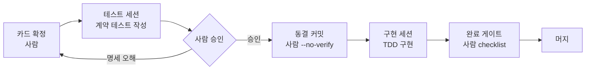

# ColorFit 하네스 운영 가이드

수직 슬라이스 하네스를 이 프로젝트에 적용하면서 정한 규칙과 절차를 한곳에 모은 문서. 하네스 원리는 [README.md](README.md), 설계 문서는 [`project-all-docs/`](project-all-docs/README.md)에 있다.

> 핵심 세 가지
> 1. **세션은 `project/`에서 연다.** 최상위 폴더 세션은 문서·카드 동기화용이다.
> 2. **세션에는 카드 1장만 프롬프트로 준다.** 카드 파일은 `project/` 밖에 둔다.
> 3. **계약 테스트 동결은 git 커밋이다.** 커밋은 사람만 하고, 커밋된 계약 테스트는 hook이 막는다.

---

## 1. 폴더와 세션

```
youcam-project/                 ← 최상위 세션: foundation, 카드 작성, 문서 동기화
├── README-HARNESS.md           ← 이 문서
├── project-all-docs/           ← 사람용 총괄 문서. 슬라이스 세션은 열지 않는다
│   ├── api.md · erd.md · feature-graph.md(.html) · roadmap.md
│   ├── context-card/{slice}.md ← 슬라이스당 1장
│   ├── prompts/{slice}-*.md    ← 카드를 붙인 완성 프롬프트 (복사해서 붙여넣기)
│   ├── checklist.md · approvals.md · loop-config.md
│   └── ColorFit_PRD.md
└── project/                    ← 테스트 세션·구현 세션은 여기서 연다
    ├── CLAUDE.md · Makefile · .claude/ · .githooks/
    ├── backend/  (FastAPI · uv · pytest)
    ├── front/    (React · Vite · Vitest)
    ├── e2e/      (Playwright)
    └── docker-compose.yml
```

| 세션 | 여는 위치 | 하는 일 | 보는 것 |
|---|---|---|---|
| 최상위 세션 | `youcam-project/` | foundation 구축, 카드 작성, 계약 변경 시 문서·카드 동기화 | 전체 문서 |
| 테스트 세션 | `project/` | 계약 테스트 작성 | 카드 1장 + `common/` `shared/` `conftest.py` (feature 열람 금지) |
| 구현 세션 | `project/` | 슬라이스 구현 (TDD) | 카드 1장 + 동결된 계약 테스트 + 레퍼런스 슬라이스 |

- 테스트 세션과 구현 세션은 **반드시 서로 다른 새 세션**이다. 같은 세션에서 이어 하면 명세 오해를 걸러내지 못한다.

### 관리자 경로와 작업 경로

| | 관리자 경로 `youcam-project/` | 작업 경로 `project/` |
|---|---|---|
| 설정 | `youcam-project/.claude/settings.json` → `env.HARNESS_ADMIN=1` | `project/.claude/settings.json` (deny / ask / hook) |
| 커밋 | pre-commit이 `HARNESS_ADMIN=1`을 보면 바로 통과 → 커밋·푸시·병합·수정 자유 | pre-commit 검사 전부 적용 |
| 상위 경로 | - | `project-all-docs/**`, 루트 `*.md`, `.gitignore` 읽기·쓰기 deny. `.git/**` 쓰기 deny. Bash의 `cd ..`, `../`, 문서 절대경로, `git -C ..`, `HARNESS_ADMIN` 포함 명령 deny |

- 관리자 세션을 여러 개 열어도 모두 같은 설정을 쓴다. 설정이 파일에 있어서 세션마다 따로 지정할 필요가 없다.
- `project/` 세션은 상위 폴더의 settings.json을 읽지 않는다. 그래서 `HARNESS_ADMIN`이 주입되지 않는다.
- Bash deny는 문자열 패턴 검사라서 스크립트 파일이나 변수로 우회할 수 있다. 완전히 막으려면 sandbox가 필요하다. 이 경우에도 사람이 보는 diff에는 드러난다.
- deny 경로가 `/home/najunho/youcam-project`로 고정돼 있다. 다른 위치에 clone하면 `project/.claude/settings.json`을 수정해야 한다.
- 루트에 `CLAUDE.md`를 두지 않는다. `project/` 세션이 상위 폴더의 CLAUDE.md를 읽기 때문에, 관리자용 규칙이 작업 세션에 섞인다.

---

## 2. 초기 진행 (완료)

| # | 단계 | 결과물 | 상태 |
|---|---|---|---|
| 1 | 템플릿 clone, `make setup` (git 훅 연결) | `core.hooksPath = project/.githooks` | ✅ |
| 2 | PRD → API·ERD 설계 (해커톤 최소) | `api.md`, `erd.md` (테이블 5개) | ✅ |
| 3 | 슬라이스 분해 · 의존 그래프 | `feature-graph.md` · [시각화](https://claude.ai/artifact/EENXqTaw8uAd1yL7917SxL) | ✅ |
| 4 | 로드맵 | `roadmap.md` (마감 11/02) | ✅ |
| 5 | Makefile 스택 명령 + 린트 룰 | import-linter (백), eslint `no-restricted-paths` (프론트) | ✅ |
| 6 | foundation (공용 레이어) | `common/` `shared/` `conftest.py` 스캐폴딩 · Docker | ✅ |
| 7 | 슬라이스 카드 8장 | `context-card/*.md` (미정 칸은 `{미정}`으로 표시) | ✅ auth 완성, 나머지 미정 있음 |

**foundation은 하네스 밖에서 만들었다.** 공용 레이어라 계약 테스트가 없고 모든 슬라이스의 바닥이 된다. 그래서 사람이 승인한 상태로 최상위 세션이 직접 만들고, 커밋은 사람이 `HARNESS_APPROVED=1`로 했다. 기록은 `approvals.md`에 있다.

---

## 3. 슬라이스 사이클



### ① 카드 확정 (사람)
- 카드에 `{미정}`이 남아 있으면 시작하지 않는다. 빈칸이 있다는 건 설계가 덜 됐다는 뜻이다.
- 최상위 세션에 카드를 쓰게 할 때는 **명세에 없는 칸을 채우지 말고 보고하라**고 지시한다.
- 완성 프롬프트를 `project-all-docs/prompts/{slice}-test-session.md`, `{slice}-implementation-session.md`로 만든다. 템플릿은 `project/docs/prompts/`에 있다.

### ② 테스트 세션
1. `project/`에서 새 세션을 열고 `{slice}-test-session.md` 내용을 붙여넣는다.
2. 세션이 `backend/test/contract/{slice}/`에 계약 테스트 3~7개를 작성한다. 아직 커밋 전이라 hook이 허용한다.
3. 세션이 남긴 질문에 답한다. 질문이 나왔다는 건 대개 카드가 모호하다는 뜻이니 카드도 고친다.

### ③ 승인 → 동결 (사람)
- 테스트를 읽고 명세와 맞는지 확인한다. 여기서 걸러야 하는 건 테스트 버그보다 명세 오해다.
- 승인하면 커밋한다. **이 커밋부터 hook이 해당 슬라이스의 계약 테스트를 막는다.**
```bash
cd /home/najunho/youcam-project/project && git add backend/test/contract/{slice} && git commit --no-verify -m "contract: {slice} 동결"
```

### ④ 구현 세션
1. 동결됐는지 확인한다. 아래 명령의 출력이 없어야 한다.
```bash
cd /home/najunho/youcam-project/project && git status --short backend/test/contract
```
2. 슬라이스 브랜치를 만든다.
```bash
cd /home/najunho/youcam-project && git switch -c slice/{slice}
```
3. `project/`에서 **새 세션**을 열고 `{slice}-implementation-session.md` 내용을 붙여넣는다.
4. 세션이 TDD로 단위 테스트를 먼저 쓰고 구현한다. 완료 기준은 `SLICE={slice} make test-slice`와 `make lint` 통과다.
5. 공용 레이어 변경이 필요하다고 보고하면 → [6. 계약·공용 변경 처리](#6-계약공용-변경-처리)

### ⑤ 완료 게이트 (사람) → 머지
- `git diff --stat`에 `test/contract/`가 없는지 확인한다. Bash 우회 수정은 hook이 못 잡기 때문이다.
- [checklist.md](project-all-docs/checklist.md) 항목을 전부 확인한다. 계약·단위·E2E 테스트, 로딩·빈 상태·에러 화면 육안 확인, 슬라이스 밖 변경 없음 등이다.
- 커밋과 머지는 사람이 한다.

### 순서와 병렬
| 단계 | 슬라이스 | 방식 |
|---|---|---|
| 1 | **auth** (레퍼런스) + product_ingest | auth는 단독. 구조를 먼저 제안받고 승인한다. 완성되면 `_reference-slice/`를 대체한다 |
| 2 | profile · personal_color · wardrobe | 병렬 (worktree, 동시 2~3개 상한) |
| 3 → 5 | swipe → recommendation → fitting | 순차 |

---

## 4. 보호 장치

### 경로별 등급

| 등급 | 경로 | 툴 호출 시점 (`.claude/`) | 커밋 시점 (`.githooks/pre-commit`) |
|---|---|---|---|
| **하드** | `backend/test/contract/`, `front/test/contract/` | 커밋된 슬라이스는 **hook**이 Edit/Write 거부. `rm`, `mv`, `git rm`은 `deny` | 항상 차단. `HARNESS_APPROVED`로도 안 풀림 → 사람이 `--no-verify` |
| **소프트** | `backend/src/common/`, `backend/src/shared/`, `front/src/common/`, `front/src/shared/`, `e2e/` | `ask` (승인 프롬프트) | 차단 → 사람이 `HARNESS_APPROVED=1` |
| **소프트 (설정)** | `CLAUDE.md`, `Makefile`, `.claudeignore`, `.githooks/`, `.claude/`, `backend/pyproject.toml`, `backend/uv.lock`, `backend/test/conftest.py`, `front/package.json`, `front/package-lock.json`, `front/eslint.config.js`, `front/test/setup.ts` | `ask` | 차단 → 사람이 `HARNESS_APPROVED=1` |
| **조립 지점** | `backend/src/main.py` `FEATURE_ROUTERS`, `front/src/app/App.tsx` 슬라이스 라우트 구역 | 제한 없음 (CLAUDE.md 규칙: 자기 줄만 추가) | 제한 없음 |
| **슬라이스** | `*/src/feature/{slice}/`, `*/test/unit/{slice}/` | 제한 없음 | 린트 통과해야 함 |

- **슬라이스 간 import**는 pre-commit이 `make lint`로 검사한다. `HARNESS_APPROVED`로도 풀리지 않는다. 승인할 문제가 아니라 설계 오류이기 때문이다.
- 우회 시도(`--no-verify`, `-n`, `HARNESS_APPROVED=*`)는 세션에서 `ask`가 뜬다. 세션이 시도하면 사용자 눈에 보인다.
- `--dangerously-skip-permissions`는 쓰지 않는다. `ask`가 전부 무력화된다.

### 계약 테스트 동결 hook
- 파일: [`project/.claude/hooks/protect-frozen-contract.py`](project/.claude/hooks/protect-frozen-contract.py) (PreToolUse, `Edit|Write|MultiEdit|NotebookEdit`)
- 규칙: `test/contract/{slice}/` 안에 git이 추적하는 파일이 **하나라도** 있으면 그 슬라이스의 수정과 새 파일 추가를 막는다.
- 이 방식을 고른 이유: deny는 테스트 세션과 구현 세션이 같은 설정 파일을 쓴다. 그래서 켜고 끄는 걸 사람이 매번 해야 하고, 한 번 잊으면 뚫린다. git 커밋을 기준으로 하면 따로 켜고 끌 게 없다.
- hook은 세션을 시작할 때 읽힌다. 설정을 바꾼 뒤에는 새 세션을 연다.

### 알려진 빈틈
| 빈틈 | 대응 |
|---|---|
| 동결 커밋 전에 구현 세션을 열면 보호받지 못한다 | 구현 세션 시작 전 `git status --short backend/test/contract` 확인 |
| Bash(`sed -i`, `python -c` 등)로 하는 수정은 hook이 못 잡는다 | pre-commit 하드 차단 + 구현 후 `git diff --stat` 확인 |
| 테스트 세션이 `feature/`를 열지 말라는 건 지시일 뿐이다 | 구현 전에 테스트를 쓰므로 볼 구현이 없다. 다른 슬라이스 코드는 볼 수 있다 |
| `project-all-docs/`는 형제 폴더라 열어볼 수 있다 | `project/` 밖이라 읽으려 하면 권한 프롬프트가 뜬다 |

---

## 5. 사람만 하는 일

- [ ] 카드 `{미정}` 칸 결정, 카드 검토
- [ ] 계약 테스트 승인 → **동결 커밋** (`--no-verify`)
- [ ] 보호 경로가 포함된 커밋 → `HARNESS_APPROVED=1 git commit` + `approvals.md` 기록
- [ ] 슬라이스 브랜치 생성, 머지
- [ ] 레퍼런스 슬라이스(auth) 구조 승인, `_reference-slice/` 정리
- [ ] 완료 게이트: checklist, 화면 육안 확인, `git diff --stat` 확인
- [ ] 외부 키 발급·입력 (`project/.env`): YouCam, 네이버 쇼핑, S3
- [ ] `make ingest` (상품 수집 배치, 하루 1회), `make up` (EC2 배포)

세션이 하지 않는 것: 커밋, `--no-verify`, `HARNESS_APPROVED`, 공용 레이어·설정·계약 테스트 수정.

---

## 6. 계약·공용 변경 처리

구현 세션이 "공용 레이어 변경 필요" 또는 "명세 불일치"를 보고하면 다음 순서로 처리한다.

1. 사람이 판단한다. 카드가 틀렸는지, 공용 타입이 부족한지 본다.
2. 최상위 세션에서 공용 타입·문서·카드를 수정한다.
3. **같은 타입을 쓰는 다른 슬라이스를 확인한다.** `feature-graph.md`의 충돌 주의 항목을 본다.
4. 이미 끝난 슬라이스면 재작업 여부를 정한다.
5. 계약 테스트를 바꿔야 하면 사람이 hook 밖에서 직접 수정하고 `--no-verify`로 커밋한다.
6. `approvals.md`에 기록하고 세션을 재개한다.

---

## 7. 명령어

`project/`에서 실행한다. 세션은 아래 타겟만 쓴다.

| 명령 | 내용 |
|---|---|
| `make setup` | 훅 연결 + 의존성 설치 (clone 직후 1회) |
| `make dev` | DB 컨테이너 + 백엔드 `:8000` + 프론트 `:5173` (`/api` 프록시) |
| `make test` | 백엔드(pytest, DB 필요) + 프론트(vitest) 전체 |
| `SLICE=auth make test-slice` | 해당 슬라이스의 계약 + 단위 테스트만 |
| `make test-e2e` | Playwright (`make dev`가 떠 있어야 함) |
| `make lint` | 슬라이스 간 import 검사 |
| `make ingest` · `make up` · `make down` | 사람용: 상품 배치 · 배포 기동 · 배포 중지 |

외부 연동은 `.env`로 모드를 바꾼다 (예시: `project/.env.example`). 테스트는 `conftest.py`가 아래 테스트용 모드로 강제한다.

| 항목 | 값 | 개발 | 테스트 | 배포 |
|---|---|---|---|---|
| `STORAGE_MODE` | `s3` / `local` / `memory` | local | memory | s3 |
| `YOUCAM_MODE` | `live` / `mock` | mock (크레딧 절약) | mock | live |
| `EMBEDDING_MODE` | `fashion_clip` / `fake` | fashion_clip | fake | fashion_clip |

---

## 8. 정해진 설계 결정

| 결정 | 내용 | 이유 |
|---|---|---|
| 스택 | FastAPI + PostgreSQL/pgvector + React/Vite, EC2 1대 Docker Compose | 임베딩이 파이썬. 벡터DB를 따로 안 띄움 |
| 로그인 | 닉네임 + 비밀번호 (JWT 7일) | PRD는 비로그인이지만, 사진·결과를 사용자에 묶어야 해서 |
| 사진 2장 | 얼굴 사진(`selfie_key`) → 피부톤 분석 / 상반신 사진(`body_image_key`) → 피팅 원본 | YouCam 조건이 다름 (얼굴 폭 60% 이상 vs 가슴 위 상반신) |
| 시즌 판정 | 피부색 Lab: b* ≥ 18 웜 / L* ≥ 70 밝음 → 4시즌 | YouCam은 피부색 hex만 줌 |
| 피팅 입력 | URL로 전달 (S3 presigned URL, 상품 이미지 URL) | File API 업로드 단계 생략 |
| 피팅 처리 | POST 202 → 백그라운드 → 2초 폴링, (사용자, 상품) DONE 결과 캐시 | 크레딧 절약 |
| 메인 화면 | 비로그인: 시작하기·로그인 / 로그인: 이어하기(다음 단계로 이동)·로그아웃 | |
| 슬라이스 이름 | snake_case (`personal_color`) | 파이썬 패키지 제약 |
| 스키마 관리 | Alembic 없이 `create_all`. 변경 시 `docker compose down -v` | 해커톤 |
| 컷 라인 | ① wardrobe ② 스와이프 적응형 노출 ③ 추천 이유 텍스트 임베딩 | 시간 부족 시 이 순서로 제외 |

**남은 `{미정}`:** recommendation(점수 변환식, 태그 생성 방법, 폴백 기준) · fitting(상품 정보 표시, 폴링 최대 시간) · auth(E2E 담당)

---

## 9. 문제 해결

| 증상 | 원인 → 해결 |
|---|---|
| `HARNESS_APPROVED=1`인데 커밋이 안 됨 | 하드 경로(`test/contract/`)가 같이 스테이징됨 → 관리자 경로 세션에서 커밋 (훅 통과) |
| 관리자 세션인데 훅이 막음 | `HARNESS_ADMIN`은 세션 시작 시 주입됨 → `youcam-project/`에서 새 세션 |
| `docker compose` 실패 / `Cannot connect to the Docker daemon` | Docker Desktop이 꺼져 있음 → Windows에서 실행 |
| 테스트에서 컬럼이 없다는 에러 | 스키마 변경 후 기존 테이블이 남아 있음 → `docker compose down -v` 후 `make test` |
| 실제 YouCam 호출이 개발 중 실패 | local 저장소 URL(localhost)은 YouCam이 접근할 수 없음 → S3 모드에서만 live 사용 |
| hook 변경이 적용되지 않음 | 세션 시작 시점에 읽힘 → 새 세션 |
