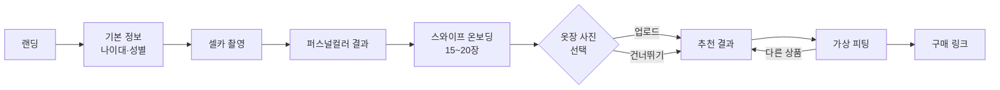
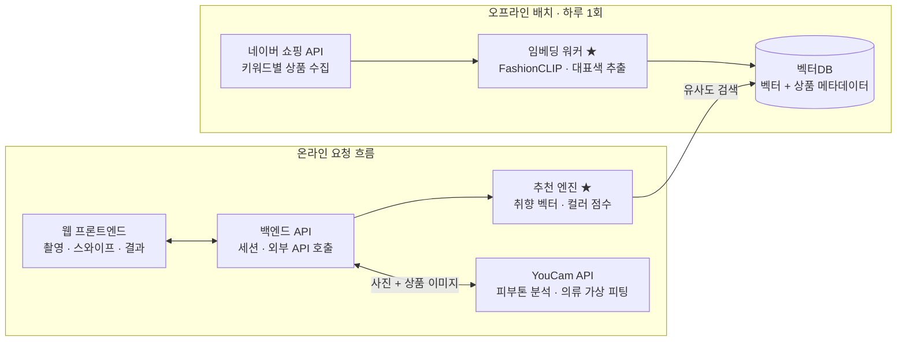

# ColorFit (가칭) PRD

작성일: 2026-10-07 · 작성자: 나준호

---

## 1. 서비스 개요

ColorFit은 셀카 한 장과 스와이프 20번으로 "나에게 어울리고, 내 취향인 옷"을 찾아 바로 입혀보고 살 수 있게 해주는 웹 서비스다. YouCam API Skin AI & eCommerce VTO Hackathon(제출 마감 2026-11-02) 출품작으로 기획한다.

**문제**

- 온라인 쇼핑에서 옷은 많지만 "나한테 어울리는지"와 "내 취향인지"를 동시에 판단하기 어렵다.
- 퍼스널컬러 진단은 따로, 쇼핑은 따로 이뤄져서 진단 결과가 구매로 이어지지 않는다.
- 입어볼 수 없으니 구매를 망설이거나, 사고 나서 반품한다.

**해결책**

- 피부톤 분석으로 퍼스널컬러를 진단하고 (YouCam API)
- 스와이프 온보딩과 착용 사진으로 취향을 벡터로 분석한 뒤 (직접 구현)
- 두 점수를 합쳐 네이버 쇼핑의 실제 상품을 추천하고
- 추천 상품을 내 사진에 가상 피팅해서 (YouCam API) 구매 링크로 연결한다.

**타깃**

- 1차: 온라인으로 옷을 자주 사는 20~30대 남녀
- 퍼스널컬러에 관심은 있지만 진단 결과를 쇼핑에 활용하지 못하는 사용자

**차별점**

- "어울림(퍼스널컬러)"과 "취향(선호 스타일)"을 분리해서 점수화하고, 추천 이유를 함께 보여준다.
- 입어본 옷이 곧 살 수 있는 실제 상품이다 (가상 피팅 → 유사 상품이 아니라, 실제 상품 → 가상 피팅).
- 회원가입 없이 3분 안에 첫 추천까지 도달하는 온보딩.

---

## 2. UX 시나리오

사용자는 8개 화면을 거쳐 첫 추천과 가상 피팅까지 도달하며, 옷장 사진 단계만 건너뛸 수 있다.

### 페르소나 시나리오

> 24살 대학생 지민은 다음 주 면접 끝나고 입을 가을 니트를 찾고 있다. 무신사를 30분째 넘겨봤지만 다 비슷해 보이고, 자기가 웜톤인지 쿨톤인지도 잘 모른다. ColorFit에서 나이와 성별을 고르고 셀카를 찍자 "가을 웜톤" 결과가 나온다. 옷 사진 20장을 좋아요/싫어요로 넘기고, 인스타에 저장해둔 코디 사진 3장을 올린다. "미니멀 · 오버핏 선호, 가을 웜톤에 어울리는 베이지·카멜"이라는 분석과 함께 니트 5개가 추천된다. 마음에 드는 니트를 눌러 자기 사진에 입혀보고, 바로 구매 페이지로 이동한다.

### 화면 흐름



1. **랜딩**: 서비스 소개 한 줄과 "시작하기" 버튼. 회원가입 없이 바로 시작.
2. **기본 정보**: 나이대(10대 후반 / 20대 / 30대 / 40대 이상)와 성별 선택. 스와이프 이미지 풀을 정하는 데 쓰인다.
3. **셀카 촬영·업로드**: 정면 얼굴 사진 한 장. 촬영 가이드(정면, 자연광, 화장 최소화)를 보여준다. 이 사진은 가상 피팅에도 재사용하므로 상반신까지 나오게 안내한다.
4. **퍼스널컬러 결과**: 피부톤 분석 결과(시즌 타입, 대표 팔레트)를 보여주고 다음 단계로 넘어간다.
5. **스와이프 온보딩**: 옷 이미지 15~20장을 한 장씩 좋아요/싫어요로 스와이프. 진행률 표시. 처음엔 스타일별로 골고루 섞어서 보여준다.
6. **옷장 사진 (선택)**: 좋아하는 착용 사진이나 내 옷 사진 3~4장 업로드. "건너뛰기" 가능.
7. **추천 결과**: 취향 분석 요약(선호 스타일 태그 2~3개 + 퍼스널컬러)과 추천 상품 카드 목록. 카드마다 추천 이유, 가격, "입어보기" 버튼.
8. **가상 피팅**: "입어보기"를 누르면 3단계 사진에 해당 상품을 입힌 결과를 보여준다. 원본과 비교 보기, "구매하러 가기"(네이버 쇼핑 상품 링크), 다른 상품 입어보기.

### 예외 흐름

- 얼굴 인식 실패 → 재촬영 안내와 촬영 가이드 다시 표시
- 스와이프에서 좋아요가 3개 미만 → 추가 이미지 5장을 더 보여주거나, 해당 나이·성별 인기 상품으로 기본 추천
- 가상 피팅 실패나 지연 → 상품 이미지만 보여주고 재시도 버튼 제공

---

## 3. 핵심 기능

MVP는 아래 6개 기능으로 구성하며, F1·F5는 YouCam API, F2·F3·F4는 직접 구현, F6은 네이버 쇼핑 API를 쓴다.

| ID | 기능 | 설명 | 구현 주체 | 우선순위 |
| --- | --- | --- | --- | --- |
| F1 | 퍼스널컬러 진단 | 셀카로 피부톤을 분석해 시즌 타입과 추천 팔레트를 산출 | YouCam 피부톤 분석 API | 필수 |
| F2 | 스와이프 온보딩 | 나이·성별에 맞는 의류 15~20장을 스타일별로 섞어 노출, 좋아요/싫어요 수집 | 직접 구현 | 필수 |
| F3 | 옷장 사진 분석 | 착용 사진 3~4장을 업로드해 취향 분석에 추가 반영 (가중치 높게) | 직접 구현 | 선택 (MVP 간소화) |
| F4 | 개인화 추천 | 취향 벡터와 퍼스널컬러 점수로 상품 랭킹, 추천 이유 태그 생성 | 직접 구현 | 필수 |
| F5 | 가상 피팅 | 추천 상품을 사용자 사진에 입힌 결과 생성, 원본과 비교 | YouCam 의류 가상 피팅 API | 필수 |
| F6 | 구매 연결 | 상품 가격·쇼핑몰·구매 링크 제공 | 네이버 쇼핑 검색 API | 필수 |

**MVP 범위 밖 (향후 계획)**

- 실제 옷장 전체 등록과 보유 옷 기반 코디 조합
- 하의·신발·가방 등 상의 외 카테고리 피팅
- 회원 계정, 추천 기록 저장, 피드백(추천 결과 좋아요)으로 취향 재학습
- 피부 분석(15가지 피부 고민) 기반 스킨케어 상품 추천 확장

---

## 4. 추상적 구현 스펙

추천 계산은 미리 임베딩해 둔 상품 벡터에서 처리하고, 외부 API는 상품 수집·피부톤 분석·가상 피팅 세 곳에서만 호출한다.

### 시스템 구성



★ = 직접 구현하는 부분

상품 데이터는 하루 한 번 배치로 벡터DB에 쌓고, 사용자 요청 시에는 취향 벡터로 검색만 하므로 추천 응답이 빠르다.

### 4.1 데이터 파이프라인 (오프라인 배치)

1. 수집 키워드 = 성별 × 나이대 × 스타일(미니멀, 캐주얼, 스트릿, 포멀, 러블리 등) × 카테고리(MVP는 상의)
2. 네이버 쇼핑 검색 API로 키워드당 상위 N개 상품 수집
3. 상품 이미지는 임시로 받아 임베딩과 대표색 추출에만 쓰고 저장하지 않음
4. 저장 항목: 벡터, 상품명, 가격, 쇼핑몰, 구매 링크, 이미지 URL, 성별, 나이대, 스타일, 카테고리, 대표색(Lab)
5. 하루 1회 갱신해 가격 변동, 품절, 링크 만료에 대응

### 4.2 취향 분석

- 임베딩 모델: FashionCLIP 또는 Marqo-FashionSigLIP, 모든 벡터는 L2 정규화
- 취향 벡터 u는 좋아요(L), 옷장 사진(C), 싫어요(D) 벡터 평균의 가중 합을 다시 정규화한 값

```
u = normalize( mean(L) + w_c × mean(C) − β × mean(D) )
w_c ≈ 1.5~2,  β ≈ 0.5
```

- 스와이프 노출 순서: 처음 8~10장은 스타일별로 균등하게, 이후엔 현재 취향 벡터와 유사도가 중간인 이미지를 우선 노출 (시간 남으면 적용)
- 추천 이유: 스타일 설명 문장(예: minimal style, oversized fit)을 텍스트 임베딩해 u와 가장 가까운 태그 2~3개 추출
- 옷장 사진: 배경 제거나 상의 영역 크롭 후 임베딩

### 4.3 퍼스널컬러 매칭

- YouCam 피부톤 분석 결과를 시즌 타입으로 변환하고, 시즌별 팔레트(Lab 좌표 목록)를 직접 정의한 매핑 테이블로 관리
- 컬러 점수 = 상품 대표색과 팔레트 내 가장 가까운 색의 Lab 거리(ΔE)를 0~1 점수로 변환

### 4.4 랭킹

- 1차 필터: 성별, 나이대, 카테고리 (벡터DB 메타데이터 필터)
- 최종 점수 = α × 취향 유사도 + (1 − α) × 컬러 점수, α 기본값 0.7로 두고 데모하며 조정
- 상위 5개 노출, 스와이프에서 이미 본 상품은 제외

### 4.5 외부 API

| API | 용도 | 호출 시점 | 주의 |
| --- | --- | --- | --- |
| YouCam 피부톤 분석 | 퍼스널컬러 진단 | 셀카 업로드 시 1회 | 크레딧 소모 |
| YouCam 의류 가상 피팅 | 추천 상품 피팅 | 사용자가 입어보기를 누를 때만 | 크레딧 소모, 의류 이미지 조건 확인 |
| 네이버 쇼핑 검색 | 상품 수집 | 오프라인 배치 | 일일 호출량 제한 |

### 4.6 제약과 원칙

- 크레딧: 개발 중엔 응답을 저장해 목업으로 작업, 같은 사진 × 상품 피팅 결과는 캐시
- 개인정보: 비로그인, 사용자 사진은 세션 동안만 보관 후 삭제. YouCam도 입력 데이터를 처리 후 24시간 내 자동 삭제
- 저작권: 상품 이미지는 저장하지 않고 URL만 보관
- 성능 목표: 추천 결과 1초 이내 (가상 피팅 제외)

### 4.7 열린 질문

- [ ] 의류 가상 피팅 API가 지원하는 카테고리와 입력 이미지 조건
- [ ] 피부톤 분석, 가상 피팅 1회당 크레딧 소모량
- [ ] 해커톤 심사 기준과 제출물 형식 (데모 영상, 배포 URL 등)
- [ ] 임베딩 모델 라이선스
