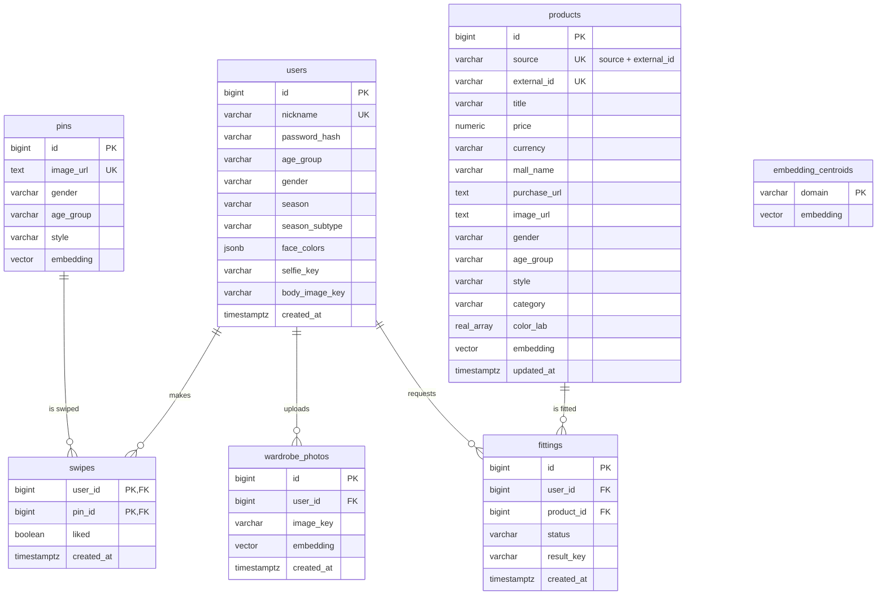

# 전체 ERD

> 테이블, 관계, 제약. 사람용. 세션에는 슬라이스 카드의 "스키마 발췌"로만 전달한다.

해커톤 최소 설계: **테이블 7개.** 취향 벡터·추천 결과·팔레트는 저장하지 않는다(요청 시 계산 / 코드 상수).

## 테이블

### users — 계정 + 프로필 + 퍼스널컬러 (1:1 정보는 분리하지 않음)
| 컬럼 | 타입 | 제약 | 쓰는 슬라이스 |
|---|---|---|---|
| id | bigserial | PK | auth |
| nickname | varchar(20) | NOT NULL, UNIQUE | auth |
| password_hash | varchar(255) | NOT NULL (bcrypt) | auth |
| age_group | AgeGroup | NULL (프로필 입력 전) | profile |
| gender | Gender | NULL | profile |
| season | Season | NULL (진단 전) | personal_color |
| season_subtype | SeasonSubtype | NULL (진단 전). season 과 함께 쓰고 함께 NULL | personal_color |
| face_colors | jsonb | NULL (진단 전). YouCam 얼굴 색 분석 응답 그대로: `{ skin, lip, eye, eyebrow, hair, eyeColorName, hairColorName }`. 판정 근거(`analysis`)는 저장하지 않고 이 값으로 다시 계산 | personal_color |
| selfie_key | varchar(255) | NULL. 얼굴 사진. S3 키 `selfies/{userId}/{uuid}.jpg` | personal_color (피부톤 분석) |
| body_image_key | varchar(255) | NULL. 상반신 사진. S3 키 `body-images/{userId}/{uuid}.jpg` | personal_color (쓰기) · fitting (원본으로 읽기) |
| created_at | timestamptz | NOT NULL DEFAULT now() | |

### products — 쇼핑 상품(eBay, 추후 네이버) + 임베딩 (벡터DB 역할)
| 컬럼 | 타입 | 제약 |
|---|---|---|
| id | bigserial | PK |
| source | ProductSource | NOT NULL. 지금은 `EBAY` 만 |
| external_id | varchar(100) | NOT NULL. 출처의 상품 ID (eBay `itemId`). UNIQUE `(source, external_id)` = 배치 upsert 키 |
| title | varchar(255) | NOT NULL (eBay 제목은 최대 80자) |
| price | numeric(10,2) | NOT NULL |
| currency | varchar(3) | NOT NULL. ISO 4217 (eBay 는 `USD`, 네이버는 `KRW`) |
| mall_name | varchar(100) | NOT NULL. eBay 는 판매자 이름 |
| purchase_url | text | NOT NULL |
| image_url | text | NOT NULL (외부 URL. 이미지 저장 X) |
| gender | Gender | NOT NULL |
| age_group | AgeGroup | NOT NULL |
| style | Style | NOT NULL (수집 키워드 기준) |
| category | Category | NOT NULL |
| color_lab | real[3] | NOT NULL. 대표색 Lab |
| embedding | vector(512) | NOT NULL. L2 정규화 |
| updated_at | timestamptz | NOT NULL |

- 인덱스: `(source, gender, age_group, category)`. 상품 수천 개 규모라 벡터 인덱스(HNSW)는 생략 — 필터 후 전수 계산으로 충분.
- 쓰기는 `product_ingest`만. 나머지 슬라이스는 읽기 전용.

### pins — 스와이프용 코디 사진 (Pinterest)
| 컬럼 | 타입 | 제약 |
|---|---|---|
| id | bigserial | PK |
| image_url | text | NOT NULL, UNIQUE. `i.pinimg.com` 원본 URL (이미지는 저장하지 않음) |
| gender | Gender | NOT NULL |
| age_group | AgeGroup | NOT NULL |
| style | Style | NOT NULL (수집 검색어 기준) |
| embedding | vector(512) | NOT NULL. fashion_clip |
| created_at | timestamptz | NOT NULL DEFAULT now() |

- 인덱스: `(gender, age_group)`. 개발 전 1회 적재(Playwright 크롤링), 서버는 읽기만.
- **적재 스크립트가 레포에 없다.** 핀 데이터는 DB 와 백업 dump(`project/backend/var/db-backup-20261026/pins.sql`)에만 있다. DB 를 다시 만들 때는 반드시 복원한다 (roadmap.md "DB 재생성 절차").

### embedding_centroids — 출처별 임베딩 평균
| 컬럼 | 타입 | 제약 |
|---|---|---|
| domain | EmbeddingDomain (`PIN` `PRODUCT`) | PK |
| embedding | vector(512) | NOT NULL. 해당 테이블 전체 embedding 평균 |
| updated_at | timestamptz | NOT NULL |

- 핀(코디 전신샷)과 상품(상품컷)은 사진 종류가 달라 임베딩에 공통 성분이 생긴다. 추천은 각자 평균을 뺀 뒤 비교한다. 적재할 때 계산.

### swipes — 좋아요/싫어요 (핀 대상)
| 컬럼 | 타입 | 제약 |
|---|---|---|
| user_id | bigint | PK, FK → users.id ON DELETE CASCADE |
| pin_id | bigint | PK, FK → pins.id ON DELETE CASCADE |
| liked | boolean | NOT NULL |
| created_at | timestamptz | NOT NULL DEFAULT now() |

### wardrobe_photos — 옷장 사진 (F3, 선택)
| 컬럼 | 타입 | 제약 |
|---|---|---|
| id | bigserial | PK |
| user_id | bigint | NOT NULL, FK → users.id ON DELETE CASCADE |
| image_key | varchar(255) | NOT NULL. S3 키 `wardrobe/{userId}/{uuid}.jpg` |
| embedding | vector(512) | NOT NULL |
| created_at | timestamptz | NOT NULL DEFAULT now() |

- 사용자당 최대 4장 (애플리케이션 검사).

### fittings — 가상 피팅 결과 + 캐시
| 컬럼 | 타입 | 제약 |
|---|---|---|
| id | bigserial | PK |
| user_id | bigint | NOT NULL, FK → users.id ON DELETE CASCADE |
| product_id | bigint | NOT NULL, FK → products.id ON DELETE CASCADE |
| status | FittingStatus | NOT NULL |
| result_key | varchar(255) | NULL (DONE일 때만). S3 키 `fittings/{userId}/{id}.jpg` |
| created_at | timestamptz | NOT NULL DEFAULT now() |

- UNIQUE `(user_id, product_id)` — 캐시 키. 실패 후 재시도는 같은 행을 `PENDING`으로 갱신.
- 사진을 다시 올리면 해당 사용자의 `fittings` 행을 삭제(원본이 바뀌므로 캐시 무효).

## 저장하지 않는 것
- 취향 벡터 / 추천 결과: 요청 시 swipes(핀) + wardrobe_photos + embedding_centroids로 계산 (스와이프 20개 평균이라 수 ms)
- 시즌별 팔레트, 스타일 태그 텍스트 임베딩: 코드 상수 / 서버 기동 시 1회 계산
- enum은 DB enum 타입 대신 `varchar` + 애플리케이션 enum (마이그레이션 단순화)
- 스키마 관리: 해커톤이라 Alembic 없이 `create_all` + 시드. `create_all` 은 이미 있는 테이블에 컬럼을 추가하지 않으므로 스키마가 바뀌면 DB 를 다시 만든다. 볼륨을 통째로 지우면 핀이 사라지므로 roadmap.md 의 "DB 재생성 절차"(백업 → 재생성 → 핀·사용자 복원)를 따른다
