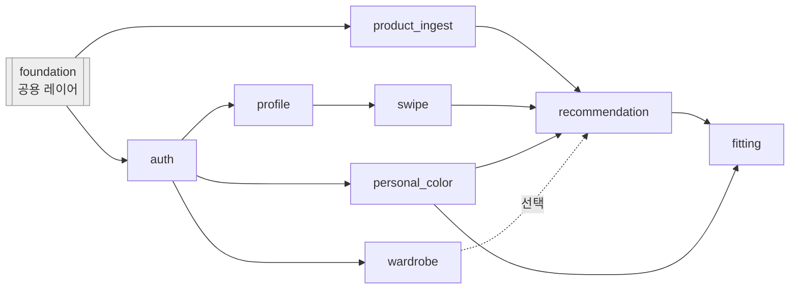

# 피쳐 의존 그래프

> 슬라이스 목록, 상하류, 병렬 가능 묶음. 시각화는 사람용, 상하류 한 줄은 세션 프롬프트(카드)로.

슬라이스 이름은 백·프론트 폴더명과 동일하며 **snake_case**(파이썬 패키지 제약).

실선 = 데이터가 있어야 동작, 점선 = 없어도 동작(있으면 반영).
슬라이스끼리 import는 없다. "의존"은 **DB 데이터 / 화면 흐름** 의존이며, 공유 코드는 전부 `common/`·`shared/`에 있다.

## foundation (슬라이스 아님 — 사람 승인 하에 먼저 구축)

| 위치 | 내용 |
|---|---|
| `backend/src/common/` | SQLAlchemy 모델 5개(entity), DTO(Pydantic), enum, ErrorCode |
| `backend/src/shared/` | config(env), DB 세션, `current_user` 의존성 + JWT(security), 에러 핸들러(exception), S3 업로드/presign, YouCam 클라이언트, 임베딩 모델 로더, 팔레트(12유형·피해야 할 색)·Lab 유틸·퍼스널컬러 판정 함수 |
| `backend/src/main.py` | FastAPI 앱 조립 (각 슬라이스 router include) |
| `front/src/common/type/` | 백엔드 DTO·enum과 1:1 타입 |
| `front/src/shared/` | api 클라이언트(fetch + 토큰), auth(토큰 저장·라우트 가드), ui(버튼·로딩·에러) |
| `front/src/app/` | 라우터 조립 (각 슬라이스 페이지 연결) |
| 루트 | `docker-compose.yml`, `.env.example`, pyproject, package.json, 린트 룰 |

## 슬라이스 목록

| 슬라이스 | 화면 / 역할 | 상류 | 하류 | 같은 테이블 쓰는 피쳐 | 병렬 묶음 |
|---|---|---|---|---|---|
| auth | 랜딩 · 회원가입 · 로그인 | foundation | profile, personal_color, wardrobe | users(쓰기: profile, personal_color) | 1 (레퍼런스, 단독) |
| product_ingest | (백 전용 배치) eBay 수집 → 착용컷 제외 → 임베딩·대표색 → products upsert → 상품 평균 갱신 | foundation | recommendation, fitting | products, embedding_centroids(PRODUCT) (유일한 쓰기) | 1 (auth와 병렬 가능 — 화면 없음) |
| profile | 기본 정보 (나이대·성별) | auth | swipe | users.age_group/gender | 2 |
| personal_color | 얼굴·상반신 사진 업로드 · 12유형 결과 + 판정 근거 | auth | recommendation, fitting | users.season/season_subtype/face_colors/selfie_key/body_image_key, fittings(사진 변경 시 삭제) | 2 |
| wardrobe | 옷장 사진 업로드 (건너뛰기 가능) | auth | recommendation | wardrobe_photos | 2 |
| swipe | 스와이프 온보딩 | profile, product_ingest | recommendation | swipes | 3 |
| recommendation | 추천 결과 · 구매 링크 | swipe, personal_color, (wardrobe) | fitting | 읽기 전용 | 4 |
| fitting | 가상 피팅 · 원본 비교 · 구매 링크 | recommendation, personal_color | - | fittings | 5 |

## 충돌 주의

- `users`: auth·profile·personal_color가 **서로 다른 컬럼**만 쓴다. 다른 슬라이스 컬럼은 건드리지 않는다.
- `fittings`: personal_color가 사진 재업로드 시 삭제, fitting이 생성·갱신.
- 조립 지점(`backend/src/main.py`, `front/src/app/`)은 슬라이스마다 한 줄씩 추가 → 병렬 머지 시 충돌 가능. 라인 추가만 허용.

## 구현 순서

1. foundation (사람 + 승인 세션)
2. auth 단독 → `_reference-slice` 대체. 동시에 product_ingest (화면 없는 배치라 레퍼런스와 안 겹침)
3. profile · personal_color · wardrobe 병렬
4. swipe
5. recommendation
6. fitting
